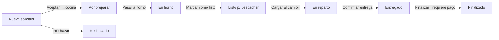

# 🍕 Masa Prima — Venta mayorista de pizzas

Sistema web para una fábrica de pizzas que vende **por caja a comercios** (pizzerías, rotiserías, almacenes, clubes, comedores, caterings). Resuelve las dos puntas del negocio:

- **Tienda online para clientes**: catálogo, carrito por cajas con descuento automático por volumen y checkout con datos de facturación argentinos (CUIT, condición de IVA).
- **Panel interno para la fábrica**: recepción de solicitudes, producción en cocina, hoja de reparto, cobranzas y reportes de pedidos finalizados.

Construido sobre **Laravel 13 + Livewire 4 + Flux + Tailwind CSS 4**.

---

## Índice

- [Qué ofrece](#qué-ofrece)
  - [Tienda para clientes](#tienda-para-clientes)
  - [Panel interno de la fábrica](#panel-interno-de-la-fábrica)
  - [Cuentas y seguridad](#cuentas-y-seguridad)
- [Circuito de un pedido](#circuito-de-un-pedido)
- [Reglas de negocio](#reglas-de-negocio)
- [Modelo de datos](#modelo-de-datos)
- [Stack técnico](#stack-técnico)
- [Instalación](#instalación)
- [Usuarios de demostración](#usuarios-de-demostración)
- [Tests y calidad de código](#tests-y-calidad-de-código)
- [Estructura del proyecto](#estructura-del-proyecto)
- [Pendientes](#pendientes)

---

## Qué ofrece

### Tienda para clientes

| Pantalla | Ruta | Qué hace |
|---|---|---|
| **Inicio** | `/` | Landing con la línea de pizzas, la tabla de niveles de precio ("Más cajas, mejor precio. Automático."), el paso a paso de cómo comprar y la invitación a abrir cuenta. |
| **Catálogo mayorista** | `/catalogo` | Grilla de productos con foto, código y precio por caja. Búsqueda en vivo por variedad o código (`?q=`), filtro por categoría (aparece solo si hay más de una), carrito lateral con `+ / −` por caja. El carrito vive en sesión, así que no se pierde al navegar ni al iniciar sesión. |
| **Confirmá tu pedido** | `/pedido` | Checkout (requiere sesión). Muestra el resumen y el nivel de precio aplicado, y pide datos de facturación, entrega y forma de pago. |

**El checkout:**

- **Primer pedido:** pide razón social, CUIT y condición de IVA, y crea el *comercio* asociado a la cuenta.
- **Pedidos siguientes:** reutiliza el comercio de la cuenta (no se puede cambiar desde la tienda) y precarga la modalidad de entrega, la dirección y la franja del último pedido.
- **Entrega:** reparto a domicilio (con dirección obligatoria e indicaciones) o retiro en fábrica. Se elige el día y la franja: **mañana (8 a 12 h)** o **tarde (14 a 18 h)**.
- **Pago:** transferencia, Mercado Pago o **cuenta corriente** (solo para comercios aprobados con días de crédito asignados).
- **Validaciones:** pedido mínimo de cajas, CUIT con dígito verificador válido, CUIT que no pertenezca a otro comercio.
- Al confirmar, el pedido entra como **Nueva solicitud**, se registra en la actividad y se vacía el carrito.

### Panel interno de la fábrica

Acceso en `/admin`, solo para el personal (roles **admin** y **cocina**). Un cliente que intenta entrar recibe un 403; el personal que entra al `/dashboard` es redirigido al panel.

| Pantalla | Ruta | Qué hace |
|---|---|---|
| **Panel general** | `/admin` | Tablero del día con KPIs: solicitudes nuevas para **aceptar o rechazar** en un clic, lo que hay que producir, comandas en cocina, entregas de hoy y pedidos por cobrar. Incluye la línea de producción con la cantidad de pedidos en cada estado. Se refresca solo cada 30 s. |
| **Pedidos** | `/admin/pedidos` | Listado paginado con pestañas por estado (Nuevas, En cocina, Listos, En reparto, Entregados, Finalizados) y contador en cada una. Búsqueda por número de pedido, razón social, CUIT, código o nombre de producto. |
| **Detalle de pedido** | `/admin/pedidos/{id}` | Ficha completa: cliente, ítems, entrega, pago y la **actividad** (quién hizo qué y cuándo). Botón para avanzar al siguiente estado, rechazar, registrar el pago, asignar un camión e imprimir la comanda. Para solicitudes y pedidos en cocina muestra el **impacto en cocina**: cuántas cajas de cada variedad ya hay comprometidas para ese día y cuánto suma este pedido. |
| **Cocina** | `/admin/cocina` | Vista de producción por día (**Hoy** con atrasados incluidos, **Mañana**, **Próximos**). Totales de cajas por variedad (listas / pendientes / a confirmar), comandas agrupadas por estado (Por preparar → En horno → Listo) con check por ítem, y aparte las solicitudes por aprobar ("+N cajas si se aceptan"). Se refresca cada 15 s. |
| **Entregas y pagos** | `/admin/entregas` | Hoja de reparto del día (cargar al camión, confirmar entrega) con versión imprimible. Tabla de cobranzas con el vencimiento de cada pedido (vence al entregar, vence en X fecha, vencido hace N días) y el botón **Registrar pago**. Resumen de lo cobrado hoy. |
| **Finalizados** | `/admin/finalizados` | Reporte por período (hoy, últimos 7 días, últimos 30 días o rango personalizado): cantidad de pedidos, cajas, facturación, distribución por nivel de precio y **top 5 de productos más vendidos**. |

Cada acción del personal queda registrada en la actividad del pedido con su firma, por ejemplo *"Laura (admin) — Aceptó el pedido y lo envió a cocina."*

### Cuentas y seguridad

Basado en **Laravel Fortify**:

- **Login con CUIT o email:** los clientes pueden ingresar con el CUIT de su comercio (con o sin guiones) o con su email.
- Registro, verificación de email, recupero y cambio de contraseña.
- **Autenticación en dos pasos (2FA)** con códigos de recuperación.
- **Passkeys** (WebAuthn) para entrar sin contraseña.
- Rate limiting en login, 2FA y passkeys.
- Configuración de perfil, apariencia (claro/oscuro) y seguridad.

---

## Circuito de un pedido



- Cada transición guarda su propia marca de tiempo (`aceptado_at`, `horno_at`, `listo_at`, `reparto_at`, `entregado_at`, `finalizado_at`, `rechazado_at`) y un evento en la actividad.
- Solo se pueden **rechazar** las solicitudes que todavía no se aceptaron.
- Un pedido **no se puede finalizar si no está pagado**.
- Al pasar a *Listo*, todos los ítems quedan marcados como listos.
- La lógica del circuito está centralizada en el enum `App\Enums\EstadoPedido` (etiquetas, colores, texto de cada botón, columna de fecha y texto de actividad).

---

## Reglas de negocio

Se configuran en [`config/tienda.php`](config/tienda.php):

| Regla | Valor |
|---|---|
| Pedido mínimo | 5 cajas |
| Nivel **Inicial** | desde 0 cajas |
| Nivel **Comercio** | desde 10 cajas |
| Nivel **Distribuidor** | desde 50 cajas |

- El nivel de precio se calcula sobre el **total de cajas** del pedido: se pueden mezclar variedades.
- **Cuenta corriente:** el pago vence a los días de crédito del comercio (30 por defecto), contados desde la entrega. Para los demás medios de pago, vence al entregar.
- **Comprobante:** condición de IVA *A* → Factura A (Responsable Inscripto); *B* → Factura B (Monotributo / Exento).
- **CUIT:** validación completa del dígito verificador (`App\Rules\Cuit`).

**Catálogo actual** (5 pizzas, con foto en `public/images/productos`):

| Código | Producto |
|---|---|
| PZ-01 | Pizza Calabresa |
| PZ-02 | Pizza Jamón y Morrón |
| PZ-03 | Pizza Muzzarella |
| PZ-04 | Pizza Muzzarella con Huevo |
| PZ-05 | Pizza Napolitana |

---

## Modelo de datos


---

## Stack técnico

| Capa | Tecnología |
|---|---|
| Backend | PHP 8.3+, **Laravel 13** |
| Interfaz | **Livewire 4** (componentes de una sola página `⚡*.blade.php`), **Flux UI**, Alpine.js |
| Estilos | **Tailwind CSS 4** con paleta propia (tomate, queso, albahaca, harina, carbón…) y tipografías Anton, Work Sans e Instrument Sans |
| Build | Vite 8 (`vite-plus`) |
| Autenticación | Laravel Fortify (2FA, passkeys, verificación de email) |
| Base de datos | SQLite por defecto; compatible con MySQL y PostgreSQL |
| Tests | Pest 5 |
| Calidad | Laravel Pint, Larastan (PHPStan) |
| CI | GitHub Actions (`.github/workflows/tests.yml`) |

---

## Instalación

**Requisitos:** PHP 8.3+, Composer, Node.js y npm.

```bash
git clone <url-del-repo> masaprima
cd masaprima

# Instala dependencias, crea .env, genera la clave, migra y compila los assets
composer setup

# Carga el catálogo y, fuera de producción, los datos de demostración
php artisan db:seed

# Levanta el servidor de desarrollo con Vite
composer dev
```

Abrí `http://localhost:8000`.

> Por defecto usa SQLite (`database/database.sqlite`). Para usar MySQL (por ejemplo con XAMPP) o PostgreSQL, cambiá las variables `DB_*` en `.env` antes de migrar.

---

## Usuarios de demostración

El `DemoSeeder` (se ejecuta solo fuera de producción) crea personal, 10 comercios de la zona oeste del Gran Buenos Aires y 17 pedidos repartidos en todos los estados, con fechas relativas al día de hoy, para que el panel se vea con datos reales.

| Rol | Email | Contraseña |
|---|---|---|
| Admin | `admin@masaprima.com` | `password` |
| Cocina | `martin@masaprima.test` | `password` |

> ⚠️ Cambiá estas credenciales antes de cualquier despliegue real.

---

## Tests y calidad de código

```bash
composer test         # Pint (estilo) + PHPStan (tipos) + Pest (tests)
php artisan test      # Solo los tests
composer lint         # Formatea el código con Pint
```

Cobertura funcional principal:

- **`TiendaTest`**: home, búsqueda en el catálogo, carrito en sesión, el checkout pide login y conserva el carrito, pedido mínimo, nivel de precio, alta del comercio en el primer pedido, reutilización en los siguientes, CUIT duplicado o inválido, cuenta corriente solo para comercios aprobados.
- **`AdminTest`**: permisos por rol, carga de todas las pantallas, aceptar y rechazar solicitudes, no se puede finalizar sin pago, solicitudes visibles en cocina, impacto en cocina.
- **`LoginClientesTest`**: ingreso con CUIT (con o sin guiones) o con email, y rechazo de credenciales inválidas.
- Tests de Fortify: registro, verificación, reset de contraseña, 2FA, perfil y seguridad.

---

## Estructura del proyecto

```
app/
├── Enums/            EstadoPedido, Franja, MetodoPago, Rol
├── Http/Middleware/  EnsureUserIsPersonal (protege /admin)
├── Models/           User, Customer, Product, Order, OrderItem, OrderEvent
├── Providers/        FortifyServiceProvider (login con CUIT o email)
├── Rules/            Cuit (validación del dígito verificador)
└── Support/          Formato (moneda y fechas en español)
config/tienda.php     Nombre, pedido mínimo, niveles de precio y categorías
database/
├── migrations/       Tablas de la tienda y migración del catálogo a pizzas
├── seeders/          ProductSeeder, DemoSeeder
└── sql/              Esquema PostgreSQL normalizado de referencia
resources/views/
├── inicio.blade.php  Landing
├── layouts/          tienda, admin, auth
├── components/       tienda/* (logo, pizza, footer…) y admin/* (kpi, badge, tarjeta…)
└── pages/
    ├── ⚡catalogo, ⚡pedido          Tienda
    ├── admin/⚡panel, ⚡pedidos, ⚡pedido, ⚡cocina, ⚡entregas, ⚡finalizados
    ├── auth/                         Login, registro, 2FA…
    └── settings/                     Perfil, apariencia, seguridad
routes/web.php        Rutas de la tienda y del panel
tests/Feature/        TiendaTest, AdminTest, Auth/*, Settings/*
```

---

## Pendientes

- **Precios:** los productos todavía no tienen precio cargado (se muestran como `$ [PRECIO]`), y los niveles de precio no tienen pantalla de edición: se definen en `config/tienda.php`.
- **Exportar** desde el panel general (el botón está marcado como "pronto").
- **Notificaciones** por email y WhatsApp al cliente cuando se confirma el pedido.
- Pantallas de ABM de productos, clientes y camiones.

---

## Licencia

MIT.
